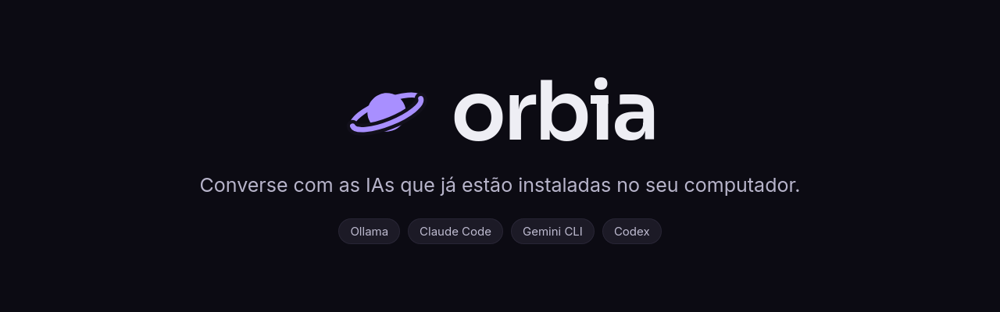
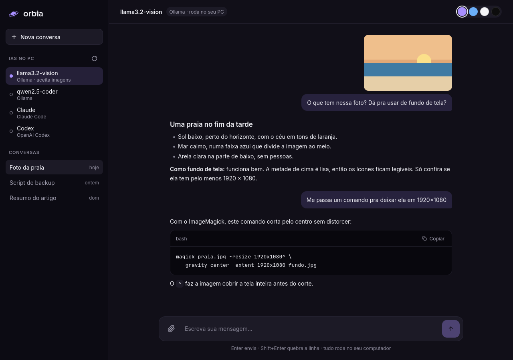
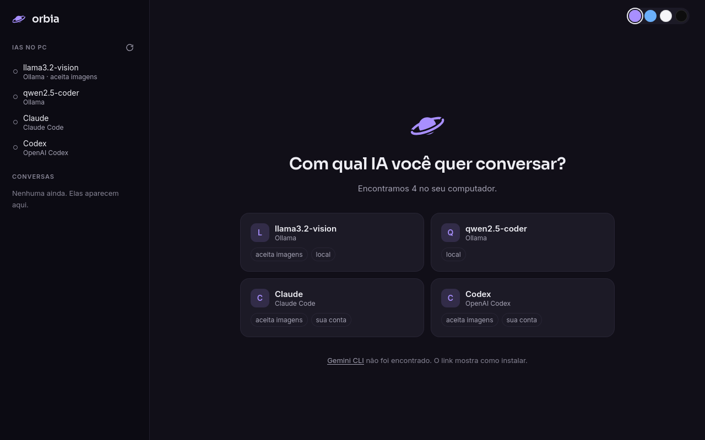
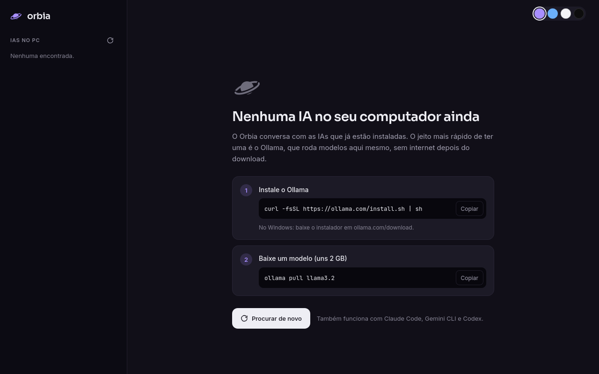
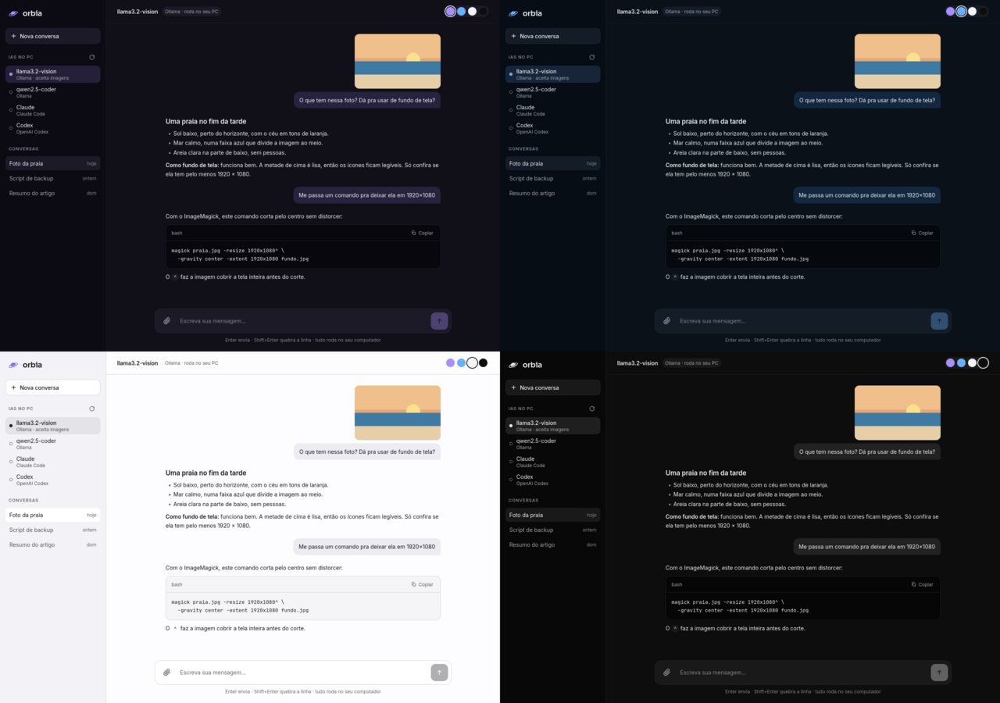

<p align="center">
  
</p>

<p align="center">
  <a href="../../releases/latest"></a>
  <a href="../../releases/latest"></a>
  
  
  
</p>

Quem tem Ollama, Claude Code, Gemini CLI ou Codex instalado conversa com eles pelo terminal: texto cru, `**` e `#` aparecendo na tela, nada de imagem. O Orbia é um app de desktop que acha essas ferramentas sozinho e abre a conversa numa tela de chat, com Markdown formatado, blocos de código com botão de copiar e imagens anexadas.

Ele não pede chave de API, não pede conta e não se conecta a nenhum serviço por conta própria. Por baixo, roda os mesmos comandos que você rodaria no terminal.

<p align="center">
  
</p>

## O que ele acha no seu PC

Ao abrir, e toda vez que você clica no botão de procurar de novo, o Orbia procura:

| Ferramenta | O que precisa estar instalado | Aparece como | Imagens |
|---|---|---|---|
| **Ollama** | o Ollama, com pelo menos um modelo baixado | um item por modelo | nos modelos com visão (`llama3.2-vision`, `llava`…) |
| **Claude Code** | o comando `claude`, já logado | Claude | sim |
| **Gemini CLI** | o comando `gemini`, já logado | Gemini | sim |
| **Codex** | o comando `codex`, já logado | Codex | sim |

Se o Ollama estiver instalado mas parado, o Orbia inicia o `ollama serve` em segundo plano. Com o Claude, digitar `/` abre a lista das suas skills e comandos, com a descrição de cada um, igual no terminal. Os CLIs instalados pelo npm, pelo nvm ou pelo bun aparecem mesmo quando o app é aberto pelo menu, que não lê o PATH do seu `.bashrc`.

<table>
  <tr>
    <td width="50%"></td>
    <td width="50%"></td>
  </tr>
  <tr>
    <td align="center"><sub>Primeira abertura: escolha com quem conversar</sub></td>
    <td align="center"><sub>Nenhuma IA ainda: os comandos já vêm prontos para copiar</sub></td>
  </tr>
</table>

## Quatro temas

Roxo é o padrão. Azul segue a mesma estrutura puxada para o azul, Branco é para usar de dia e Preto usa cinzas sem cor nenhuma. A troca fica na engrenagem do canto superior direito, aba Geral, e o app lembra a escolha.

<p align="center">
  
</p>

## Configurações

A engrenagem abre as configurações da IA da conversa atual; ao trocar de IA na barra lateral, a tela troca junto.

- **Claude:** modelo e esforço padrão (de low a max), uma instrução extra só para as conversas no Orbia, suas skills (criar, editar, apagar), plugins (instalar, ativar e desativar), MCPs (ver o status, adicionar e remover) e as regras do `~/.claude/CLAUDE.md`. As mudanças valem também no terminal. Antes de salvar um arquivo, o Orbia guarda uma cópia `.bak`.
- **Ollama:** detalhes de cada modelo, instrução de sistema, temperatura e tamanho do contexto. Ficam guardados no Orbia.
- **Codex:** esforço padrão.

Durante a conversa, o botão ⌘ ao lado do clipe troca o modelo e o esforço daquela conversa e roda comandos como `/compact` e `/context` com um clique. Com o Claude, o rodapé da barra lateral mostra quanto do plano já foi usado na sessão e na semana, e quanto falta para zerar.

## Baixar e abrir

Pegue a versão mais nova na [página de releases](../../releases/latest).

**Linux.** Baixe o `.AppImage`, marque como executável (botão direito → Propriedades → Permitir executar como programa) e abra com dois cliques. Roda no Ubuntu 22.04 ou mais novo e em distribuições da mesma época.

**Windows 10 e 11.** Baixe o `orbia.exe` e abra. Na primeira vez o Windows mostra "O Windows protegeu o computador", porque o app não tem assinatura digital. Clique em **Mais informações** e depois em **Executar assim mesmo**.

Não tem instalador e não precisa de terminal.

## Seus arquivos e seus dados

- Cada conversa é um arquivo JSON na pasta de dados do app: `~/.local/share/app.orbia.desktop` no Linux, `%APPDATA%\app.orbia.desktop` no Windows. Ela só some quando você apaga.
- Os CLIs rodam numa pasta vazia, uma por conversa, dentro da pasta de dados. Nunca na sua pasta pessoal. As imagens anexadas são copiadas para lá.
- O Codex roda em sandbox somente leitura. O Claude Code e o Gemini rodam no modo padrão, que recusa sozinho as ações que pediriam aprovação.
- O Orbia não muda a configuração de nenhuma ferramenta.
- Com o Ollama, tudo fica no seu computador. Com Claude Code, Gemini CLI e Codex, a mensagem vai para a conta que você já usa no terminal, como iria se você digitasse lá.

## Como é feito

| Parte | Tecnologia |
|---|---|
| Janela | [Tauri 2](https://tauri.app), com o navegador que já vem no sistema (WebView2 no Windows, WebKitGTK no Linux) |
| Backend | Rust. Acha os binários, roda cada CLI com lista de argumentos (nunca por um shell) e repassa a saída linha a linha |
| Tela | TypeScript sem framework, Vite, [marked](https://marked.js.org) e [DOMPurify](https://github.com/cure53/DOMPurify) |
| Fontes | Sora na marca e nos títulos, Inter no texto, JetBrains Mono no código. Todas embutidas, nada carregado da internet |

Toda resposta passa pelo DOMPurify antes de virar HTML, e a CSP do app bloqueia scripts e imagens de fora. Uma resposta com `<script>` ou com uma imagem remota não executa nem carrega nada.

```
src/                 tela (main.ts, style.css)
src-tauri/src/
  tools.rs           varredura, execução dos CLIs e do Ollama, leitura do stream
  lib.rs             comandos expostos à tela e conversas salvas em disco
.github/workflows/   build do AppImage e do .exe
docs/assets/         imagens deste README
```

## Desenvolver

Precisa de Rust, Node 20 ou mais novo e, no Linux, das bibliotecas do WebKitGTK:

```bash
sudo apt install libwebkit2gtk-4.1-dev build-essential libxdo-dev libssl-dev \
  libayatana-appindicator3-dev librsvg2-dev pkg-config
npm install
npm run tauri dev
```

Testes do backend:

```bash
cargo test --manifest-path src-tauri/Cargo.toml
```

## Gerar os instaladores

Publique uma tag de versão:

```bash
git tag v0.1.0 && git push --tags
```

O GitHub Actions monta o AppImage num runner Ubuntu 22.04 e o `.exe` num runner Windows, e anexa os dois à release. O AppImage é gerado no 22.04 porque só roda em sistemas com a glibc igual ou mais nova que a de onde foi montado.

Localmente, `npx tauri build --bundles appimage` gera um AppImage para teste em `src-tauri/target/release/bundle/appimage/`.

<br>

<p align="center">
  <br>
  <sub>As capturas deste README usam conversas de exemplo.</sub>
</p>
